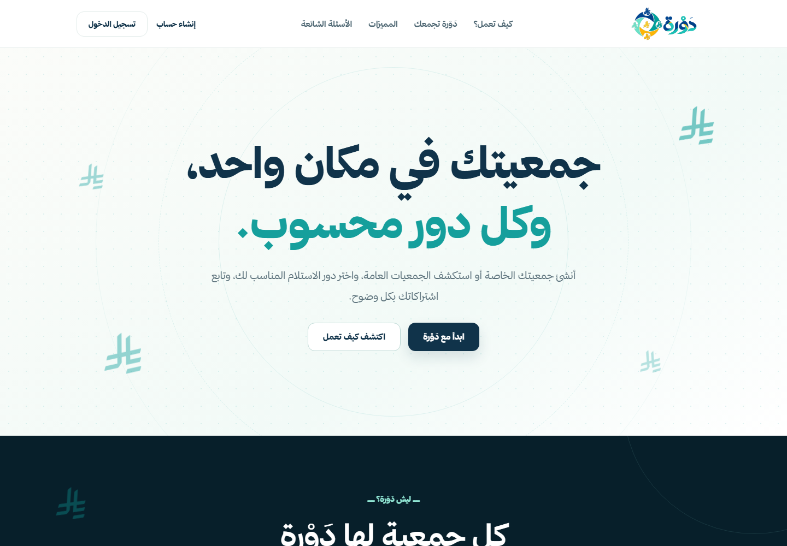
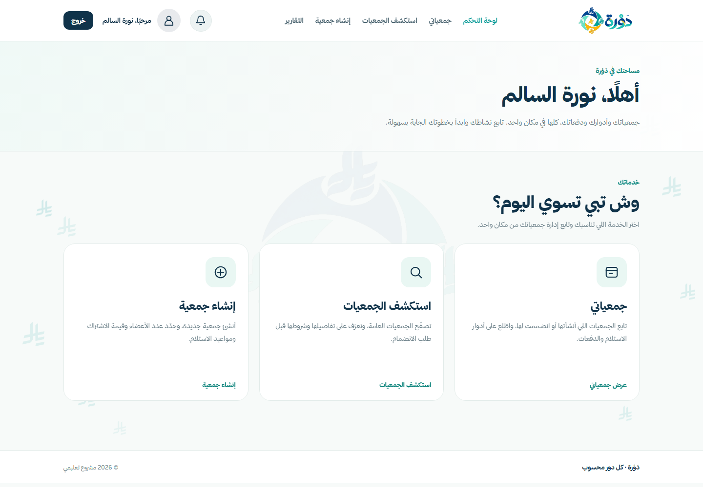
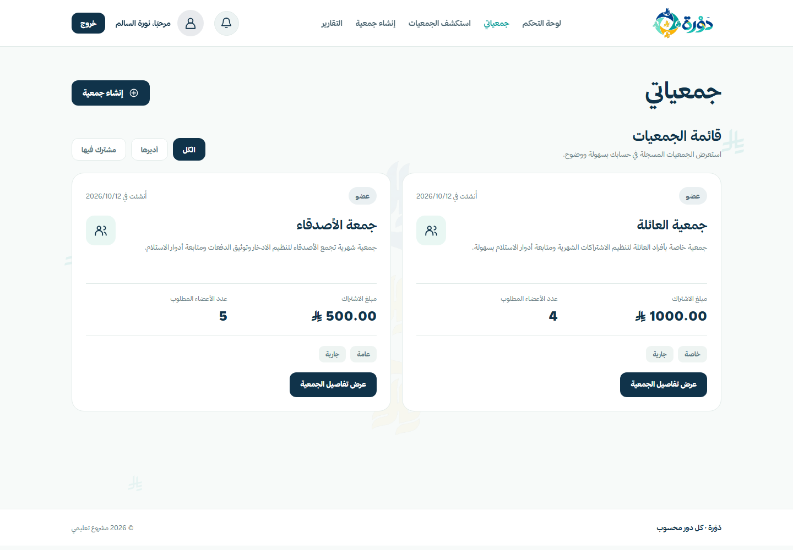
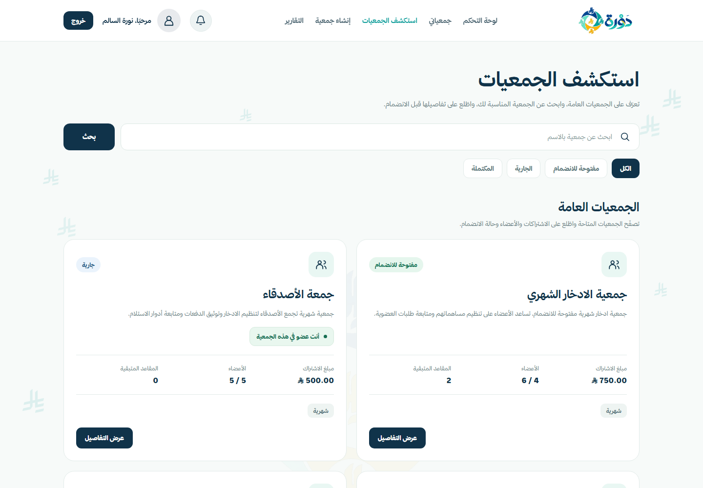
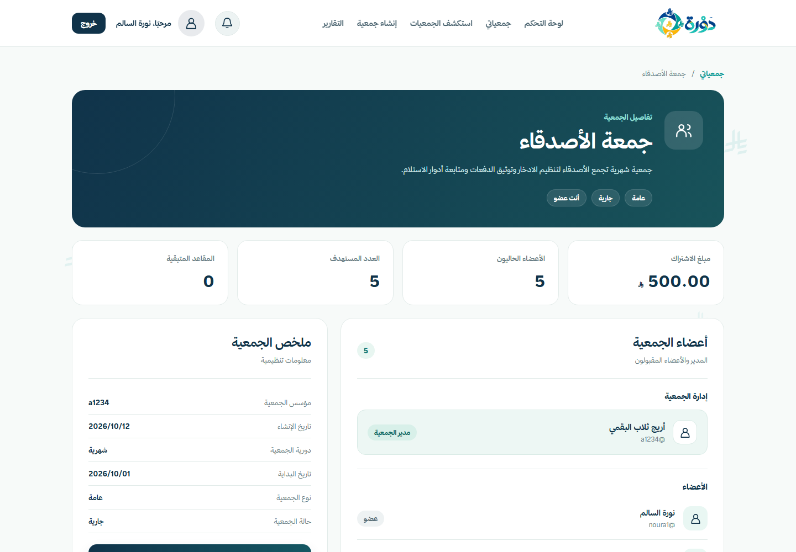
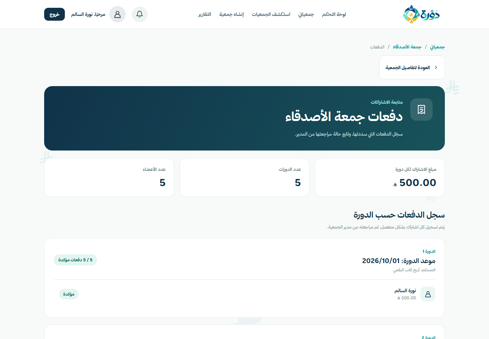
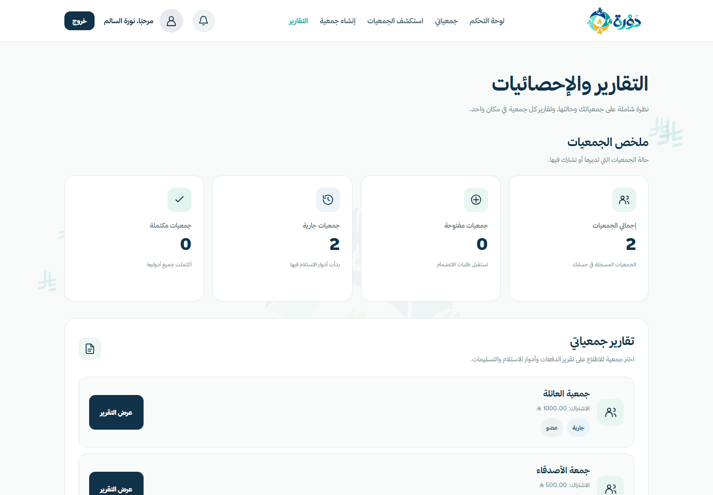

<p align="center">
  
</p>

# دَوْرة | DAWRAH

**A Django platform for managing rotating savings associations without processing real money.**

DAWRAH helps small groups organize Jamiyahs, manage memberships, schedule payout turns, record contribution reports, confirm payout delivery, and review useful summaries from one web application.

## Overview

Rotating savings associations are often managed through chat messages, spreadsheets, and informal reminders. That makes it hard to track who joined, who was approved, which turn is next, which contribution reports are still pending, and whether a payout was actually delivered.

DAWRAH addresses this problem by giving organizers and members a structured workflow:

1. Create a Jamiyah with contribution amount, capacity, visibility, frequency, and start date.
2. Accept or reject membership requests.
3. Generate payout turns once the Jamiyah is full.
4. Let members report contributions for each round.
5. Let managers verify or reject contribution reports.
6. Confirm delivery of each payout turn.
7. Mark the Jamiyah completed when all payout turns are delivered.
8. View dashboard notifications and reports.

DAWRAH does **not** process, collect, transfer, or hold real money. It records and organizes the workflow around a Jamiyah.

## Target Audience and Market Value

DAWRAH is designed for:

| Audience | Need |
|---|---|
| Jamiyah organizers | A reliable way to manage members, turns, contribution status, and delivery confirmations. |
| Jamiyah members | A clear place to see their memberships, payment rounds, payout position, and notifications. |
| Families and small social groups | A lightweight alternative to manual spreadsheets and chat-based tracking. |

The realistic value is organizational: DAWRAH reduces confusion, improves transparency, and makes the Jamiyah lifecycle easier to demonstrate and audit. It could be adopted by small private groups, community groups, or organizations that coordinate informal savings circles and need a clear record without integrating real payment processing.

## Implemented Features

- Arabic RTL user interface with responsive layouts.
- User registration, login, logout, and profile management using Django authentication.
- Public and private Jamiyah creation.
- Invitation link support for private Jamiyahs.
- Membership requests with `pending`, `approved`, and `rejected` states.
- Manager approval and rejection of join requests.
- Capacity checks before approving members.
- Payout schedule generation for full open Jamiyahs.
- Weekly or monthly payout date calculation.
- Payment reporting by approved members.
- Payment review by managers with `pending`, `verified`, and `rejected` states.
- Duplicate payment prevention per member and payout round.
- Payout delivery confirmation only after all required payments are verified.
- Jamiyah completion when all payout turns are delivered.
- Dashboard notification counts.
- Reports dashboard and per-Jamiyah reports.
- Custom Arabic 404 page.
- Automated Django tests covering authentication, workflow, reports, authorization, and data integrity.

## Screenshots

The screenshots below were captured from the actual Django application with fictional demo data.

| Page | Screenshot |
|---|---|
| Landing Page |  |
| Dashboard |  |
| My Jamiyahs |  |
| Explore Jamiyahs |  |
| Jamiyah Details |  |
| Payment Management |  |
| Reports |  |

## Tech Stack

| Layer | Technology |
|---|---|
| Backend | Python 3.13.14, Django 6.1.2 |
| Database | SQLite for local development |
| Frontend | Django Templates, HTML, CSS, JavaScript |
| Authentication | Django auth system |
| Testing | Django `TestCase` test suite |
| Configuration | Environment variables loaded with standard-library `.env` parsing |

## Project Structure

```text
DAWRAH/
|-- accounts/          # Registration, login-related profile data, dashboard notification context
|-- config/            # Project settings, root URLs, landing page, dashboard, 404 tests
|-- jamiyahs/          # Jamiyah models, forms, views, workflow, memberships, payout turns
|-- reports/           # Reports dashboard and per-Jamiyah reports
|-- transactions/      # Payment reporting and manager review
|-- templates/         # Arabic RTL templates
|-- static/            # CSS, JavaScript, logo, icons, image assets
|-- docs/              # ERD, verification record, demo guide, screenshots
|-- manage.py
`-- requirements.txt
```

## Django Apps

| App | Responsibility |
|---|---|
| `accounts` | Registration, profile management, user-level dashboard statistics, notification context processor. |
| `jamiyahs` | Jamiyah creation, exploration, membership requests, manager approvals, payout scheduling, delivery confirmation. |
| `transactions` | Contribution reporting, duplicate prevention, manager verification/rejection. |
| `reports` | Aggregated dashboard and per-Jamiyah reporting. |
| `config` | Project settings, root routes, landing page, authenticated dashboard, custom 404 tests. |

## Database Design and ORM Evidence

The implemented domain models are:

- `Profile`: one-to-one extension of Django `User` with full name and Saudi phone validation.
- `Jamiyah`: savings group metadata, contribution amount, visibility, frequency, lifecycle status, and creator.
- `Membership`: connects users to Jamiyahs with role and membership status.
- `PayoutTurn`: one payout turn per approved membership with payout order and delivery fields.
- `Payment`: contribution report for a member and payout round.

Important integrity rules include:

- Unique membership per `(jamiyah, user)`.
- Unique payout position per `(jamiyah, position)`.
- Unique payment per `(membership, payout_turn)`.
- Model validation prevents cross-Jamiyah `Payment` and `PayoutTurn` mismatches.
- Manager-only views enforce sensitive actions server-side.

ORM capabilities are integrated into application views:

| ORM Capability | Application Evidence |
|---|---|
| CRUD | Users register, Jamiyahs are created, memberships are requested/reviewed, payments are reported/reviewed, profile data can be updated. |
| Filtering | Jamiyah exploration filters by status/search; access checks filter memberships by user/status/role. |
| Ordering | Jamiyahs, memberships, payments, and payout turns are ordered for dashboards and reports. |
| Relationship queries | Views query through relationships such as `membership__user`, `jamiyah__status`, and `membership__status`. |
| Aggregation | Reports use `Count` to calculate verified, pending, and rejected payment totals. |
| Annotation | Explore/reporting code annotates related counts such as approved member counts and verified payments per payout turn. |

See [docs/ERD.md](docs/ERD.md) for the Mermaid ERD and relationship notes.

## Authentication and Authorization

DAWRAH uses Django authentication. Passwords are handled by Django and are not stored manually.

Roles are represented through `Membership.role`:

| Role | Permissions |
|---|---|
| Manager | Manage join requests, generate payout schedule, review payments, confirm payout delivery, regenerate private invitation link. |
| Member | View approved Jamiyahs, report contributions, view payment status, view reports for Jamiyahs they belong to. |
| Anonymous user | View landing page, register, log in, and browse public discoverable pages where allowed. |

Server-side checks protect sensitive operations. The UI may hide actions, but views also enforce role, membership status, and Jamiyah status rules.

## Main Workflow

1. A user registers and logs in.
2. The user creates a Jamiyah and becomes its approved manager.
3. Other users request membership.
4. The manager approves or rejects membership requests.
5. When the approved member count reaches capacity, the manager generates payout turns.
6. Approved members report contributions for payout rounds.
7. The manager verifies or rejects contribution reports.
8. The manager confirms payout delivery after all required contributions for that turn are verified.
9. After all payout turns are delivered, the Jamiyah becomes completed.
10. Members review reports and notification states.

## Installation on Windows

### 1. Clone and enter the project

```powershell
git clone <repository-url>
cd Dawrah
```

### 2. Create and activate a virtual environment

```powershell
python -m venv .venv
.\.venv\Scripts\Activate.ps1
```

If PowerShell blocks activation, run:

```powershell
Set-ExecutionPolicy -Scope Process -ExecutionPolicy Bypass
.\.venv\Scripts\Activate.ps1
```

### 3. Install dependencies

```powershell
python -m pip install --upgrade pip
pip install -r requirements.txt
```

### 4. Configure environment variables

Create a local `.env` file from the safe example:

```powershell
Copy-Item .env.example .env
```

Then set local values:

```env
DJANGO_SECRET_KEY=your-local-development-secret-key
DJANGO_DEBUG=True
DJANGO_ALLOWED_HOSTS=127.0.0.1,localhost
```

Do not commit `.env` or real secrets.

### 5. Apply migrations

```powershell
python manage.py migrate
```

### 6. Start the development server

```powershell
python manage.py runserver
```

Open:

```text
http://127.0.0.1:8000/
```

## Running Tests

```powershell
python manage.py check
python manage.py test
python manage.py makemigrations --check --dry-run
```

Latest verification for this README update:

| Command | Result |
|---|---|
| `python manage.py check` | PASS |
| `python manage.py test` | PASS, 39 tests |
| `python manage.py makemigrations --check --dry-run` | PASS, no changes detected |

Detailed verification notes are in [docs/verification.md](docs/verification.md).

## Demo Data

The screenshots and demo guide use fictional local demo accounts and Jamiyahs. Demo credentials should be shared only in a safe local classroom/demo context and should not be committed to the repository.

The project currently does not include a permanent seed command or fixture. Demo data can be created through Django Admin or the application interface.

## Known Limitations

- DAWRAH does not process or transfer real money.
- SQLite is used for local development; production concurrency would be stronger with a database such as PostgreSQL.
- Notification behavior is derived from existing workflow records rather than a dedicated notification model.
- The project is not deployed in this repository state.
- The application is Arabic-first; English localization is not implemented.
- Demo data is local and not part of a reproducible fixture.

## Documentation

- [ERD](docs/ERD.md)
- [Verification Record](docs/verification.md)
- [Demo Guide](docs/demo_guide.md)

## Acknowledgments

This project was developed as a capstone project using Django documentation, Python/Django coursework concepts, and significant AI assistance for code review, test planning, security configuration guidance, documentation drafting, and verification support. All AI-generated suggestions were reviewed and adapted to match the actual DAWRAH implementation.
