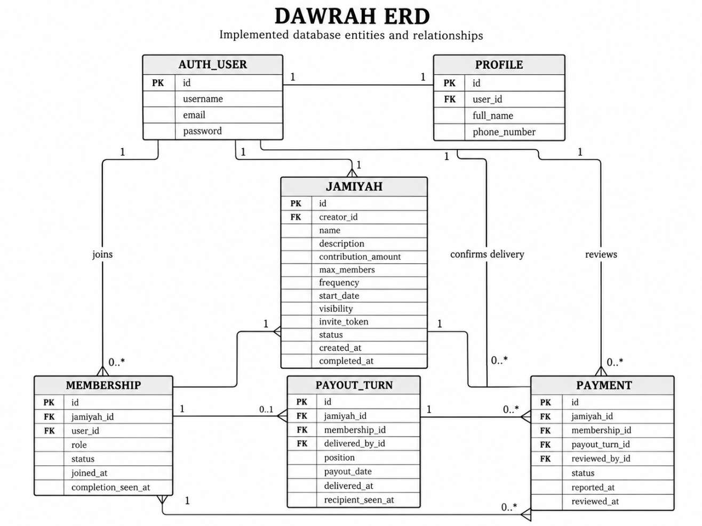
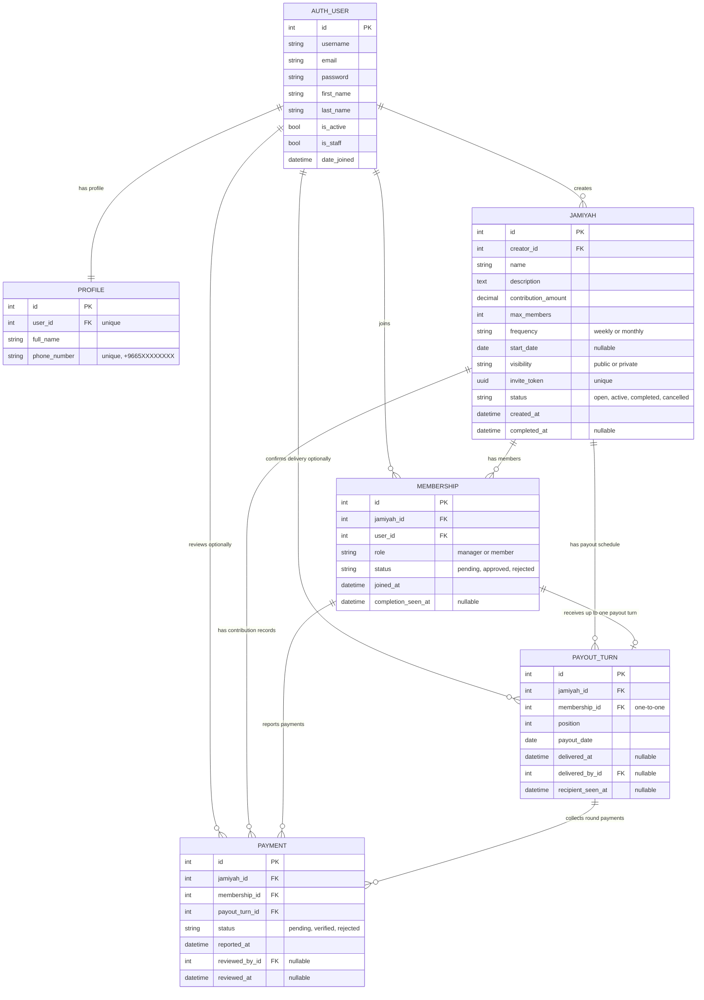

# DAWRAH ERD

This Entity Relationship Diagram (ERD) documents the Django models, their fields, and the relationships used in **DAWRAH | دَوْرة**.

## Entity Relationship Diagram

> If the SVG does not display in your Markdown viewer, open the [PNG version](images/erd-diagram.png).

View editable Mermaid diagram source

## Relationship Notes

| Relationship | Cardinality and Optionality | Implementation |
|---|---|---|
| `User` to `Profile` | One user has one profile. | `Profile.user` is `OneToOneField(User, on_delete=CASCADE)`. |
| `User` to `Jamiyah` | One user may create many Jamiyahs. | `Jamiyah.creator` is `ForeignKey(User, on_delete=PROTECT)`. |
| `Jamiyah` to `Membership` | One Jamiyah may have many memberships. | `Membership.jamiyah` is `ForeignKey(Jamiyah, on_delete=CASCADE)`. |
| `User` to `Membership` | One user may belong to many Jamiyahs. | `Membership.user` is `ForeignKey(User, on_delete=CASCADE)`. |
| `Membership` to `PayoutTurn` | An approved membership may have one payout turn. | `PayoutTurn.membership` is `OneToOneField(Membership, on_delete=CASCADE)`. |
| `Jamiyah` to `PayoutTurn` | One Jamiyah may have many payout turns after schedule generation. | `PayoutTurn.jamiyah` is `ForeignKey(Jamiyah, on_delete=CASCADE)`. |
| `Jamiyah` to `Payment` | One Jamiyah may have many contribution records. | `Payment.jamiyah` is a foreign key to `Jamiyah`. |
| `Payment` to `Membership` | One membership may have many payment records, one per payout turn. | `Payment.membership` is `ForeignKey(Membership, on_delete=CASCADE)`. |
| `Payment` to `PayoutTurn` | One payout turn may have many payment records. | `Payment.payout_turn` is `ForeignKey(PayoutTurn, on_delete=CASCADE)`. |
| `Payment.reviewed_by` | Optional reviewer. | `ForeignKey(User, null=True, blank=True, on_delete=SET_NULL)`. |
| `PayoutTurn.delivered_by` | Optional delivery confirmer. | `ForeignKey(User, null=True, blank=True, on_delete=SET_NULL)`. |

## Constraints and Data Integrity

| Model | Constraint or Rule |
|---|---|
| `Profile` | `phone_number` is unique and validated using the format `+9665XXXXXXXX`. |
| `Jamiyah` | `contribution_amount >= 1`, `max_members >= 2`, and `invite_token` is unique. |
| `Membership` | Unique `(jamiyah, user)` prevents dupliٍcate membership rows. |
| `PayoutTurn` | Unique `(jamiyah, position)` prevents duplicate payout order positions. |
| `PayoutTurn` | `clean()` ensures the selected membership belongs to the same Jamiyah and is approved. |
| `Payment` | Unique `(membership, payout_turn)` prevents duplicate contribution records for the same round. |
| `Payment` | `clean()` ensures the membership and payout turn both belong to the same Jamiyah. |

## Workflow State Model

| Entity | States |
|---|---|
| `Jamiyah.status` | `open`, `active`, `completed`, `cancelled` |
| `Membership.status` | `pending`, `approved`, `rejected` |
| `Payment.status` | `pending`, `verified`, `rejected` |

### Jamiyah Lifecycle

- **`open`**: The Jamiyah is created and can accept eligible membership requests.
- **`active`**: The payout schedule has been generated and the Jamiyah is operating.
- **`completed`**: All payout turns have confirmed delivery.
- **`cancelled`**: An eligible open Jamiyah is cancelled; its records are retained instead of being deleted.

The normal lifecycle is `open` → `active` → `completed`. Cancellation is an alternative outcome for an eligible `open` Jamiyah, not a step after completion.

> **Diagram scope:** This document describes the entities and constraints supplied for the project. Confirm field definitions and on-delete behavior against the final Django models before submission.
