# DAWRAH | دَوْرة — Illustrated Demo Guide

This guide provides a visual walkthrough of **DAWRAH**, a Django web application for managing rotating savings associations (Jamiyahs).

DAWRAH helps users create and join Jamiyahs, manage membership requests, organize payout turns, record contributions, confirm deliveries, and review reports.

**Important:** DAWRAH is a management and tracking platform. It does not execute real financial transfers.

The screenshots in this guide were captured manually from the application to demonstrate its user interface and key features.

---

## 1. Landing Page

The landing page introduces DAWRAH and its main purpose: bringing Jamiyah management, payout turns, and contribution tracking together in one place.

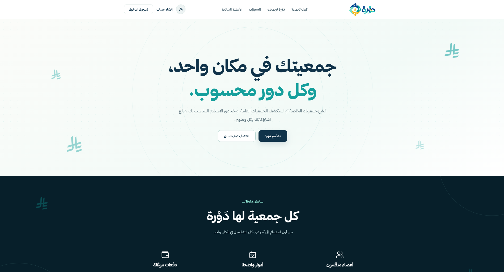

**Main features:**

- Learn how DAWRAH works.
- Explore the platform's features.
- Create a new account.
- Log in to an existing account.
- Switch between Light Mode and Dark Mode.

### Light and Dark Mode

DAWRAH supports two visual themes. Users can change the interface appearance using the theme toggle in the navigation bar.

The selected preference is managed through Django Sessions and Cookies, allowing the interface to remember the selected theme.

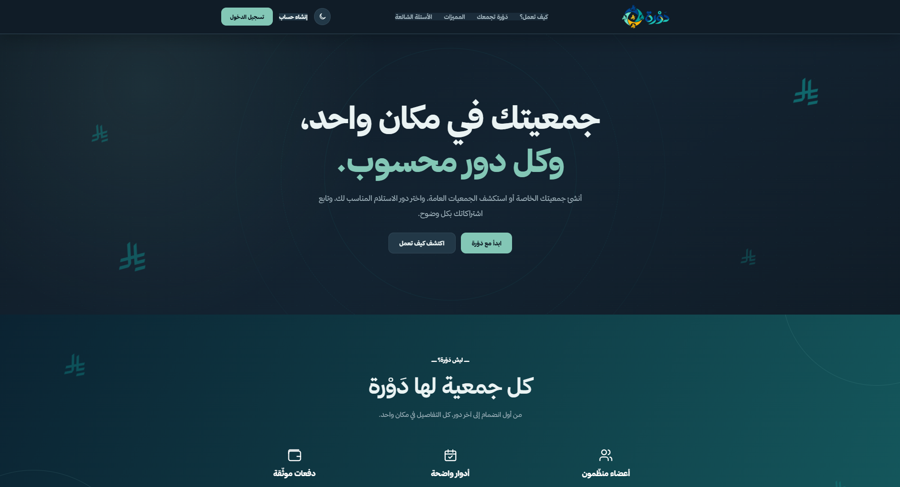

---

## 2. User Authentication

DAWRAH uses Django's authentication system to manage user registration and login.

### 2.1 Login

Existing users can sign in using their username and password.

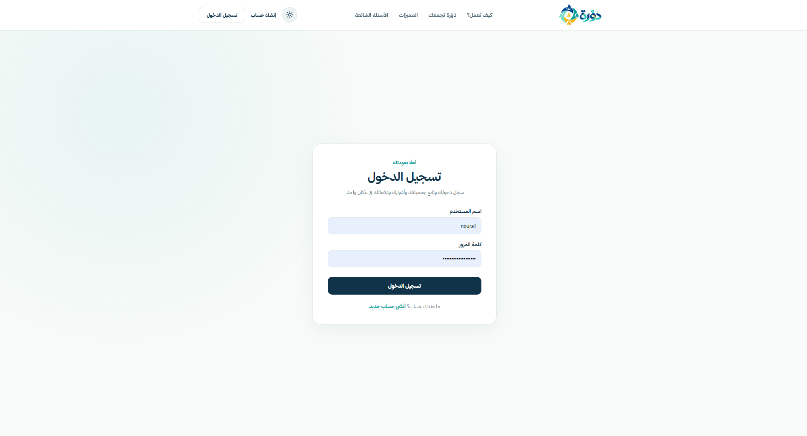

**How it works:**

1. Open the Login page.
2. Enter a valid username.
3. Enter the account password.
4. Click **تسجيل الدخول**.
5. Access the dashboard after successful authentication.

### 2.2 Registration

New users can create accounts through the registration form.

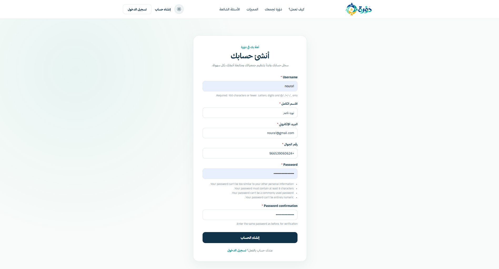

The registration form collects the information required to create a user account and profile.

**Expected outcome:** After successful registration, the user can log in and start using DAWRAH.

---

## 3. Dashboard

The dashboard serves as the main navigation point after login.

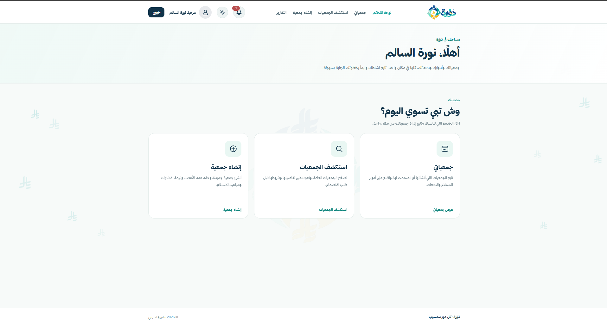

Users can access the main services:

- **جمعياتي:** View their Jamiyahs.
- **استكشف الجمعيات:** Discover available public Jamiyahs.
- **إنشاء جمعية:** Create a new Jamiyah.
- **التقارير:** Review Jamiyah statistics and reports.

The navigation bar also provides access to the profile, notifications, theme toggle, and logout.

---

## 4. My Jamiyahs

The **My Jamiyahs** page displays associations connected to the authenticated user.

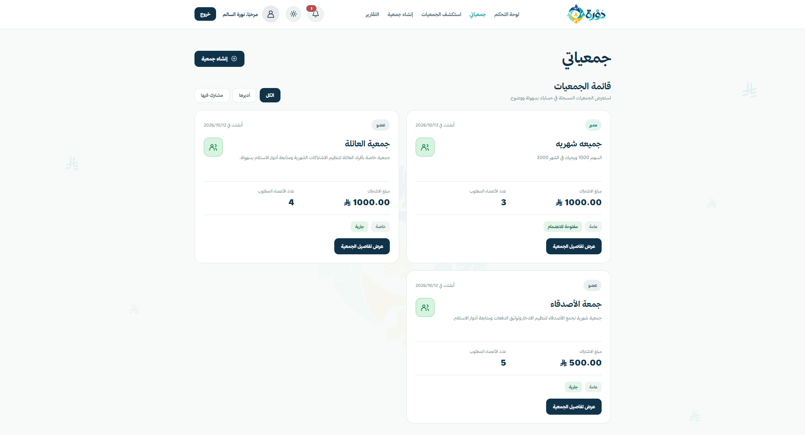

Users can:

- View Jamiyahs they manage.
- View Jamiyahs they have joined.
- Identify their role in each Jamiyah.
- Check the Jamiyah's contribution amount, capacity, and status.
- Open a Jamiyah to view more details.

DAWRAH preserves associations across their lifecycle, including open, active, completed, and cancelled states.

---

## 5. Explore Jamiyahs

The Explore page allows users to discover available public Jamiyahs.

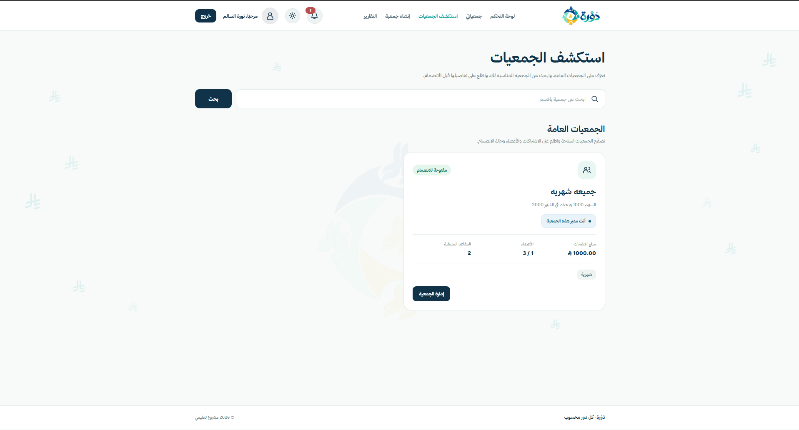

**How it works:**

1. Open **استكشف الجمعيات**.
2. Browse the available Jamiyahs.
3. Search by Jamiyah name when needed.
4. Open a Jamiyah to inspect its details.
5. Submit a membership request when eligible.

**Business rule:** Explore displays only Jamiyahs that are both **PUBLIC** and **OPEN**.

Private, active, completed, and cancelled Jamiyahs do not appear in public discovery.

---

## 6. Create a Jamiyah

Authenticated users can create and manage their own Jamiyahs.

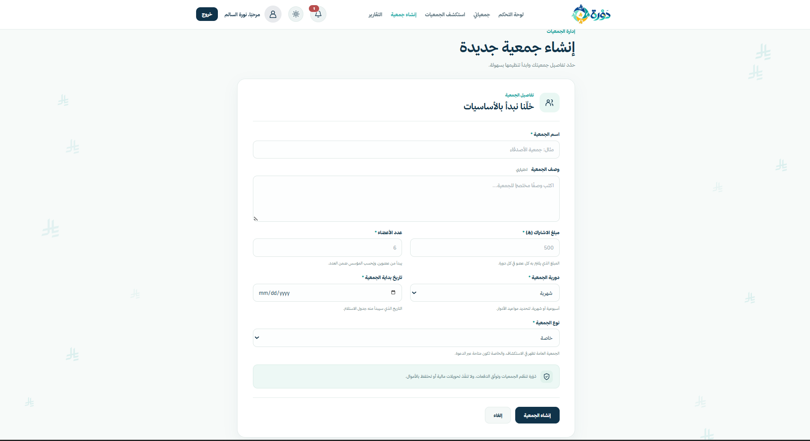

### How to create a Jamiyah

1. Click **إنشاء جمعية**.
2. Enter the Jamiyah name.
3. Optionally add a description.
4. Specify the contribution amount.
5. Set the required number of members.
6. Select the contribution frequency.
7. Choose the start date.
8. Select whether the Jamiyah is public or private.
9. Submit the form.

**Expected outcome:** DAWRAH creates the Jamiyah with an **OPEN** status. The creator becomes its manager and an approved member.

Form validation helps prevent invalid values and incomplete required information.

---

## 7. Jamiyah Details and Management

The Jamiyah Details page provides information about a specific association and the actions available to the current user.

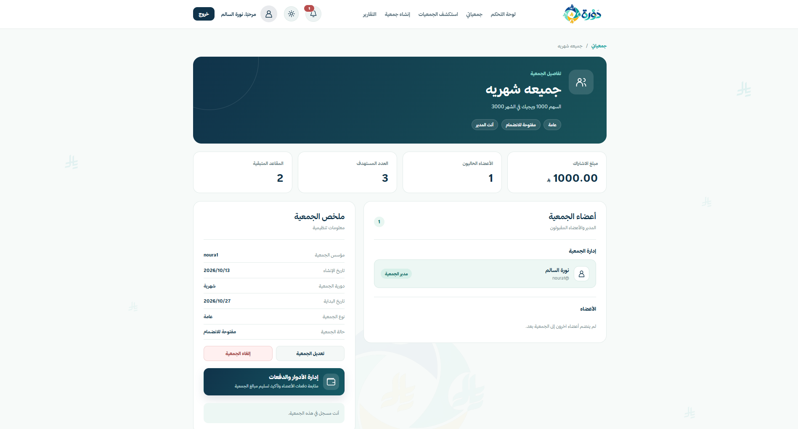

The page displays:

- Jamiyah name and description.
- Contribution amount.
- Required and approved member counts.
- Available seats.
- Status and visibility.
- Manager and member information.
- Available management actions.

### Editing a Jamiyah

An approved manager can edit an eligible Jamiyah while it remains **OPEN** and does not have a generated payout schedule.

The manager selects **تعديل الجمعية**, changes permitted information, and saves the form.

### Cancelling a Jamiyah

An approved manager can cancel an eligible OPEN Jamiyah using **إلغاء الجمعية**.

Cancellation requires confirmation and changes the Jamiyah status to **CANCELLED**.

The Jamiyah is not permanently deleted, so its existing records remain available for review.

**Important:** The screenshot above shows the management buttons. It does not depict the completed edit or cancellation confirmation workflow.

---

## 8. Membership Requests

Users can request to join eligible public Jamiyahs, while managers review incoming requests.

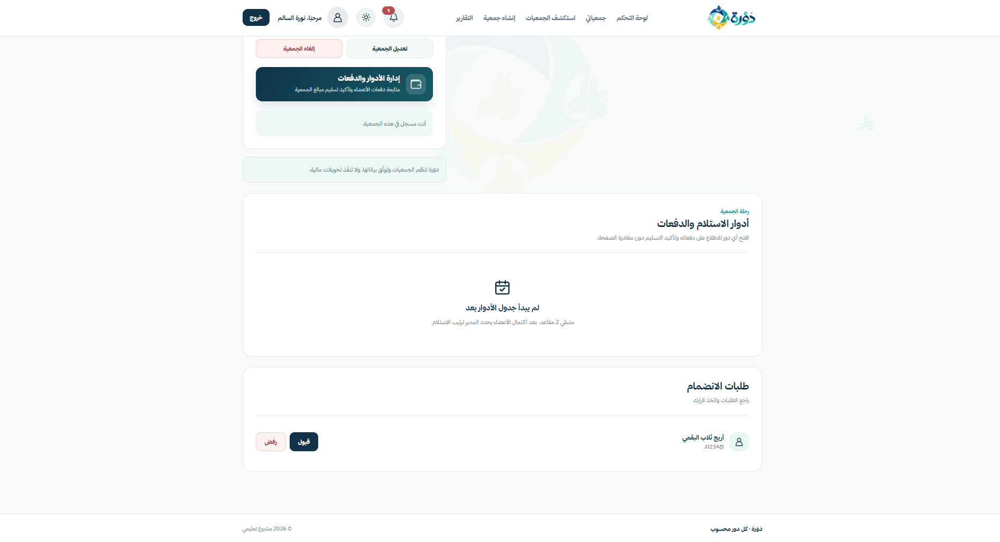

### How a member joins

1. Open a PUBLIC and OPEN Jamiyah.
2. Submit a membership request.
3. Wait for the manager's decision.

### How a manager approves or rejects a request

1. Open the managed Jamiyah.
2. Navigate to the membership requests section.
3. Review pending applicants.
4. Select **قبول** to approve a request or **رفض** to reject it.

The system tracks membership states:

- `pending`
- `approved`
- `rejected`

Approval is restricted by the Jamiyah's member capacity. Duplicate memberships are prevented.

---

## 9. Payout Schedule and Turns

When the Jamiyah meets the requirements for starting, the manager can organize the payout order and generate the schedule.

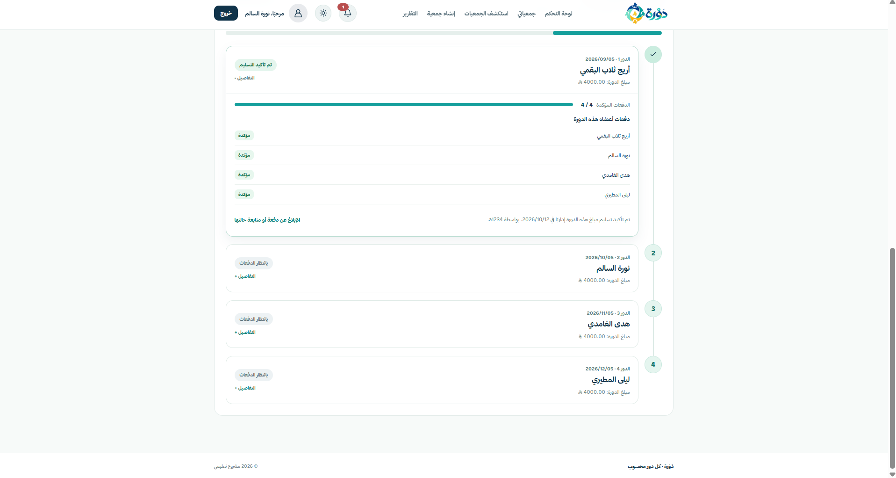

### How it works

1. Complete the required approved memberships.
2. Arrange the eligible members into payout positions.
3. Generate the payout schedule.
4. Review the payout dates and recipients.
5. Track each turn's contribution and delivery status.

Each eligible approved member receives one payout position.

The payout timeline helps members identify when their turn is scheduled and whether the required contributions have been verified.

---

## 10. Contribution Tracking and Verification

DAWRAH records contributions for each payout turn without performing actual bank transfers.

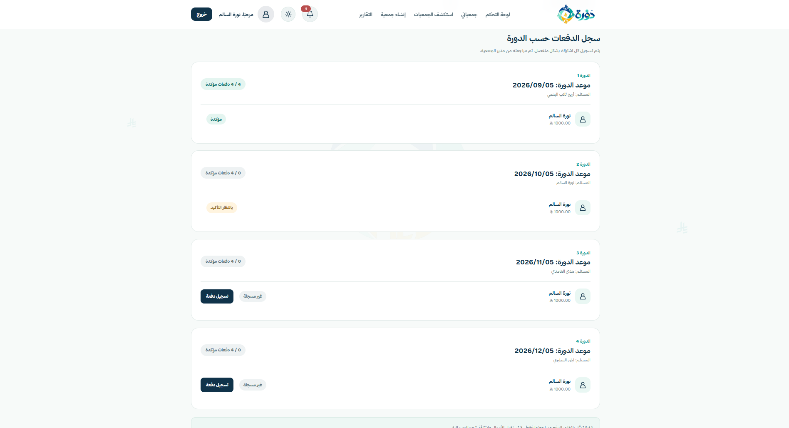

### Member workflow

1. Open the Jamiyah's payment management page.
2. Review the contribution due for each turn.
3. Use **تسجيل دفعة** when a contribution has been paid outside DAWRAH.
4. Wait for manager verification.

### Manager workflow

1. Open the payment management page.
2. Review reported contributions.
3. Verify or reject eligible payment reports.
4. Monitor the number of verified contributions in each turn.

Payment states include:

- **Pending:** The contribution report is awaiting review.
- **Verified:** The contribution has been confirmed.
- **Rejected:** The contribution report was rejected.
- **Not recorded:** No payment report has been submitted for that turn.

A payout turn may proceed to delivery confirmation only when the required contribution conditions are satisfied.

---

## 11. Delivery Confirmation and Jamiyah Completion

DAWRAH supports confirming the delivery of each payout turn.

### Confirming a payout

After all required contributions for an eligible turn have been verified, the manager can confirm that the payout was delivered outside the platform.

DAWRAH records the delivery confirmation and updates the turn's state.

### Completing a Jamiyah

When every payout turn has been delivered according to the system's business rules, the Jamiyah reaches the **COMPLETED** state.

Completed Jamiyahs remain available for recordkeeping and reports.

**Note:** The payout timeline screenshot illustrates how delivery states are presented. A separate screenshot of the final confirmation operation is not included in this guide.

---

## 12. User Profile

Users can view their account information and participation statistics through the Profile page.

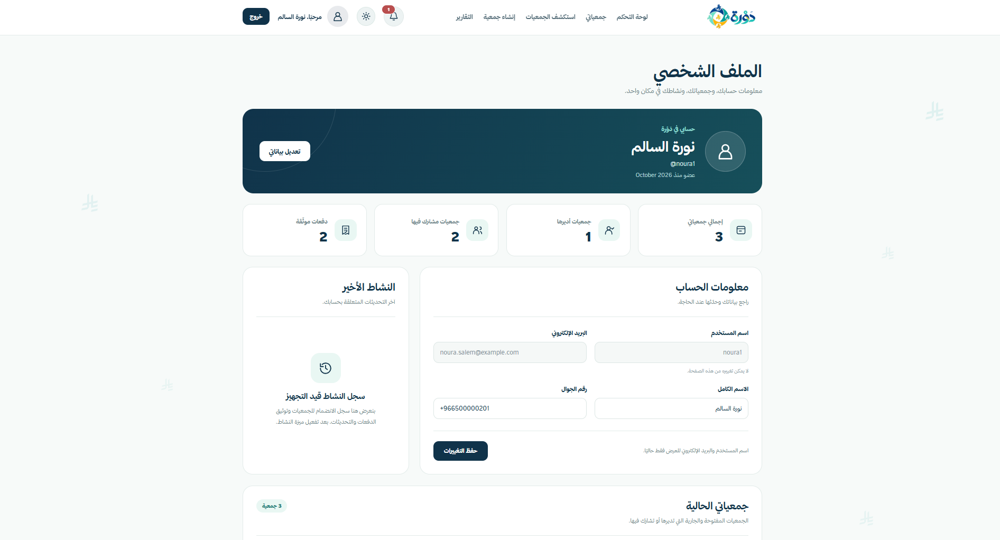

The profile contains:

- Account details.
- Editable profile information.
- Total Jamiyahs.
- Managed and joined Jamiyahs.
- Verified contribution count.
- Current Jamiyahs.
- Previous completed Jamiyahs.
- Cancelled Jamiyahs.

Jamiyahs are grouped by lifecycle state so cancelled associations are not incorrectly classified as current.

---

## 13. Reports and Statistics

DAWRAH provides summary statistics and individual Jamiyah reports.

### 13.1 Reports Dashboard

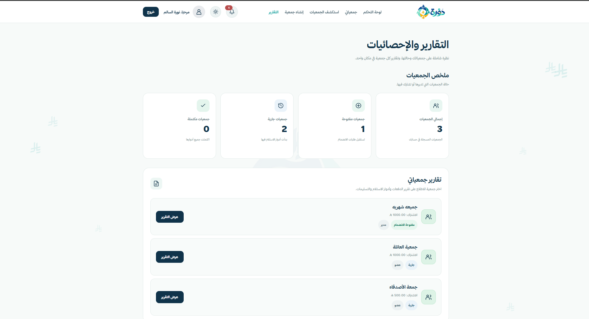

The Reports Dashboard displays:

- Total Jamiyahs.
- Open Jamiyahs.
- Active Jamiyahs.
- Completed Jamiyahs.
- Links to individual Jamiyah reports.

### 13.2 Individual Jamiyah Report

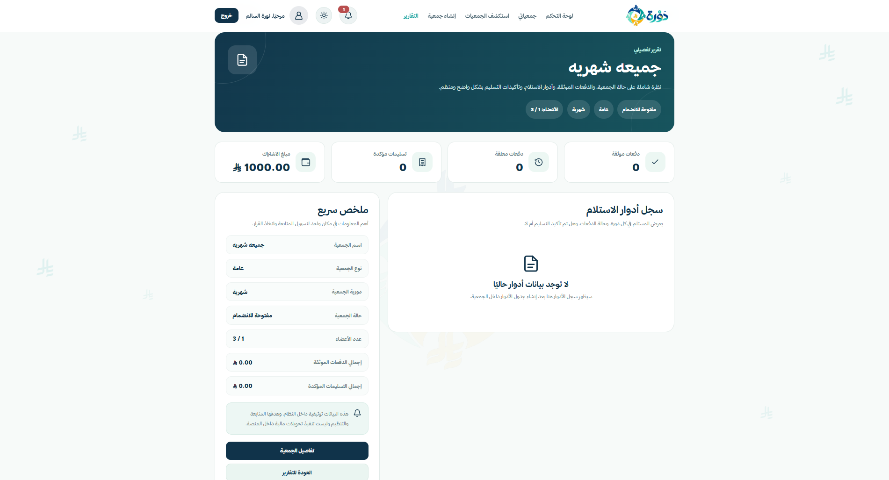

A Jamiyah report provides information such as:

- Jamiyah status and membership details.
- Verified contribution counts.
- Pending contribution counts.
- Confirmed deliveries.
- Contribution amount.
- Payout turn records.
- Recorded contribution and delivery totals.

Reports use the existing Jamiyah, membership, payment, and payout turn data.

---

## 14. Core Business Rules

DAWRAH applies rules to protect the consistency of its workflows.

| Area | Business Rule |
|---|---|
| Jamiyah creation | Required information must pass validation. |
| Membership | Duplicate membership records are prevented. |
| Membership approval | Approval must respect the maximum member capacity. |
| Jamiyah editing | Only eligible OPEN Jamiyahs can be edited by their managers. |
| Jamiyah cancellation | Eligible OPEN Jamiyahs can be cancelled without deleting their records. |
| Explore | Only PUBLIC and OPEN Jamiyahs are discoverable. |
| Payout schedule | Only approved members receive payout turns. |
| Payment records | Duplicate contributions for the same membership and turn are prevented. |
| Delivery | Delivery confirmation requires the necessary verified contributions. |
| Authorization | Manager-only actions are restricted to eligible managers. |

---

## 15. Technical Highlights

| Feature | Implementation |
|---|---|
| Backend | Python and Django |
| Database | SQLite with Django ORM |
| Authentication | Django authentication |
| Authorization | Login protection and role-based workflow checks |
| Data management | CRUD operations and ORM relationships |
| Reporting | Aggregation of contribution and payout records |
| User interface | Arabic RTL, responsive layouts |
| Theme management | Light/Dark Mode using Django Sessions and Cookies |
| Security | CSRF protection, validation, and environment-based settings |

---

## 16. Screenshot Inventory

| Filename | Screen |
|---|---|
| `01_landing_light.png` | Landing Page — Light Mode |
| `02_login.png` | Login |
| `03_register.png` | Registration |
| `04_dashboard.png` | Dashboard |
| `05_my_jamiyahs.png` | My Jamiyahs |
| `06_explore_jamiyahs.png` | Explore Jamiyahs |
| `07_create_jamiyah_form.png` | Create Jamiyah |
| `08_profile.png` | User Profile |
| `09_jamiyah_details.png` | Jamiyah Details |
| `10_membership_requests.png` | Membership Requests |
| `11_payout_timeline.png` | Payout Timeline |
| `12_payment_tracking.png` | Payment Tracking |
| `13_reports_dashboard.png` | Reports Dashboard |
| `14_jamiyah_report_detail.png` | Individual Jamiyah Report |
| `15_landing_dark.png` | Landing Page — Dark Mode |

---

## Conclusion

DAWRAH demonstrates a complete Django-based workflow for managing rotating savings associations, from account registration and Jamiyah creation to membership management, contribution tracking, payout delivery, and reporting.

The platform focuses on organization, transparency, and preserving financial workflow records without executing real financial transfers.